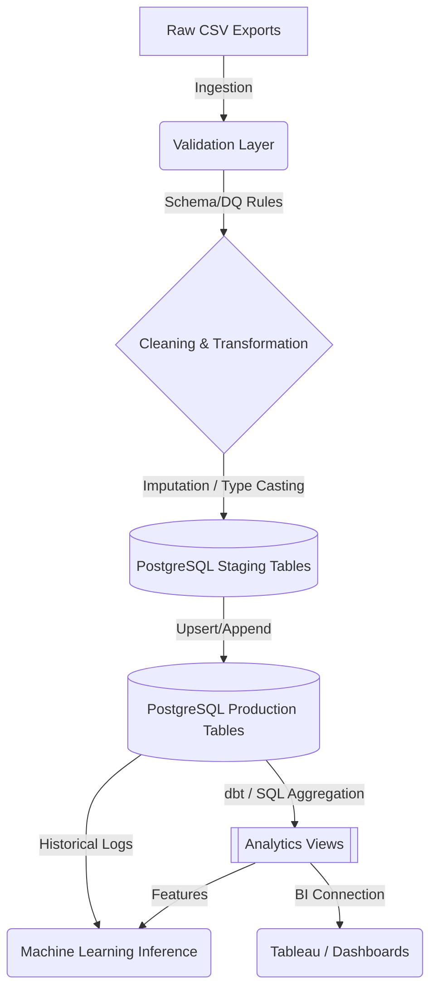

# Data Flow & Analytics Views

## 1. Future Ingestion Flow

Data moves through a rigid pipeline ensuring quality and structure before it reaches the end user or ML models.

*   **Validation Layer**: Enforces the Data Contract (nulls, ranges, types). Anomalies are logged to `data_quality_reports`.
*   **Staging Tables**: Transient tables mirroring the source format.
*   **Production Tables**: Highly normalized tables (`customers`, `loans`, `payments`).
*   **Analytics Views**: Denormalized, materialized views optimized for reads.

## 2. Analytics Views Design

To prevent heavy JOINs on the frontend or within Dashboard software, the database will expose pre-calculated Analytics Views.

### Portfolio Summary View
*   **Purpose**: Top-level snapshot of the business.
*   **Contents**: Aggregated total active principal, total funded amount, overall default rate, and total accrued interest. Grouped by current month.

### Monthly Originations View
*   **Purpose**: Tracking new business flow.
*   **Contents**: Time-series view grouping `loans` by `issue_d` (month-year). Includes count of loans, sum of `loan_amnt`, and average `int_rate` per cohort.

### Default Trends (Vintage) View
*   **Purpose**: Triangle/Vintage analysis of credit defaults over time.
*   **Contents**: Tracks cohorts of loans (by issue month) and calculates the cumulative default rate at 3, 6, 9, 12, and 24 months post-origination.

### Risk Segmentation View
*   **Purpose**: Slices the portfolio by risk grades (A-G).
*   **Contents**: Groups active loans by `grade`. Displays average `int_rate`, average `dti`, approval volume, and charge-off rate per grade.

### Customer Lifecycle View
*   **Purpose**: Tracks customer stickiness and LTV.
*   **Contents**: Denormalizes Customer data with aggregate Loan data. Identifies repeat borrower status, total lifetime principal borrowed, and total lifetime interest paid per `member_id`.

### Campaign Performance View
*   **Purpose**: Marketing ROI analysis.
*   **Contents**: Joins `marketing_campaigns`, `customers`, and `loans`. Calculates Customer Acquisition Cost (CAC) vs. total interest revenue generated by customers tied to that campaign.

### Executive KPI View
*   **Purpose**: Ultra-fast, single-row or small-table view for the C-Suite dashboard.
*   **Contents**: The 10 critical KPIs (Approval Rate, Charge-off Rate, Delinquency Rate, Portfolio Exposure, etc.) calculated for the current MTD vs. Prior MTD.
