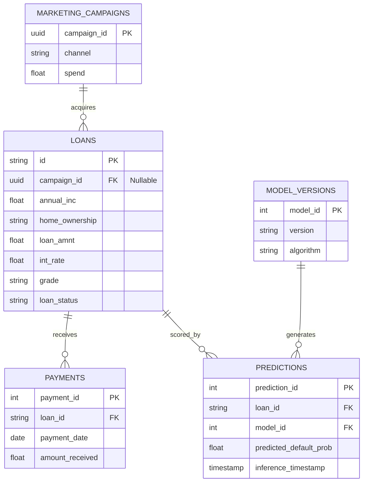

# Entity Relationship Diagram

This document illustrates the physical relationship between the core business entities in the platform.

## ER Diagram

## Relationship Explanations

1.  **Marketing Campaigns -> Loans (One-to-Many)**: A single marketing campaign can acquire thousands of loan applications, but a loan application is attributed to a single primary acquisition campaign.
2.  **Loans -> Payments (One-to-Many)**: A single loan receives dozens of installment payments over its term. A payment transaction is tied to exactly one loan.
4.  **Model Versions -> Predictions (One-to-Many)**: A single deployed credit risk model will score millions of applications, generating many predictions. Each prediction links back to the specific version of the model that generated it.
5.  **Loans -> Predictions (One-to-Many)**: A loan may be scored multiple times (e.g., once at origination, and repeatedly over its lifetime as a behavioral risk score). Thus, one loan maps to many predictions.
