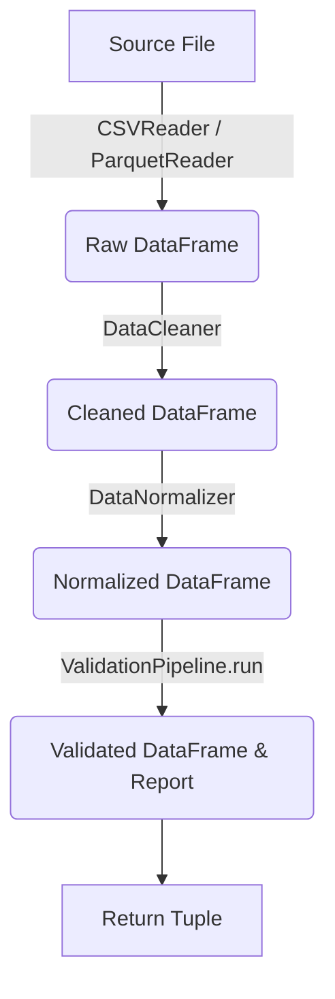

# Ingestion Architecture

The Data Ingestion Layer serves as the gateway for all datasets entering the platform. It handles the extraction, generic cleaning, and formatting normalizations necessary to prepare the data for rigid domain validation.

## 1. Pipeline Architecture
The architecture heavily employs Dependency Injection and the SOLID Interface Segregation Principle.
Components:
*   **Reader**: Extracts data from various physical formats using the `BaseReader` interface (`CSVReader`, `ParquetReader`). Can easily be extended to support database reads or REST APIs.
*   **Cleaner**: Performs strict technical cleanup that has no domain rules—dropping fully NA rows, dropping duplications, wiping trailing whitespaces, and unifying 'NA', 'None', and '' strings into standard `NaN` values.
*   **Normalizer**: Formats values dynamically based on configuration. Replaces text indicators like 'Yes'/'No' with boolean logic, strips out currency string delimiters (`$1,000` -> `1000.0`), enforces lowercase column name conventions, and unifies date formats natively using Pandas datetime casting.

## 2. Execution Flow
The orchestrator (`IngestionPipeline`) executes the flow sequentially:

The pipeline returns both the strictly cleansed Pandas DataFrame and the previously architected Pydantic `ValidationReport` produced by the inner validation engine.

## 3. Extension Points
*   **Adding Readers**: Create a custom class inheriting from the abstract `BaseReader` interface and implement the `.read(source)` method dynamically.
*   **Configuring Normalization**: The `DataNormalizer` configures date mapping, currency mapping, and boolean typing during class initialization via target column lists. Incorporating a new dataset column to cleanly parse requires zero class architecture tweaks.

## 4. Dataset Intelligence Engine
Before dataset ingestion occurs, the **Dataset Intelligence Engine** analyzes uploaded files without fully loading them into memory.

### Features & Workflow
- **Pre-Upload Analysis**: Safely peeks at headers and uses lightweight chunked reads (e.g., `pd.read_csv(nrows=100)`) to extract data types, delimiter, encoding, and row/column counts efficiently.
- **Dataset Health Report**: Emits a structured report containing metadata on Schema Validation (required/missing columns), general size limits, memory estimations, and a profiling snapshot of the dataset types.
- **Configurable Target**: Reads `settings.model_target_column` instead of relying on hardcoded targets, making the platform fully model-agnostic.
- **Smart Sampling Selection**: If the target column is found, the engine recommends and automatically prepares **Stratified Sampling**. If missing, it defaults to **Random Sampling**.
- **Memory-Efficient Processing**: For large datasets, sampling relies on C-level `skiprows` execution in Pandas. It mathematically determines which indices to load and bypasses unselected data on-the-fly, capping memory usage regardless of disk file size.

### Configurations
- `model_target_column`: The feature utilized for stratified sampling splits (e.g., `"loan_status"`).
- `max_safe_rows`: Threshold above which datasets are marked `LARGE`.
- `medium_dataset_threshold`: Threshold above which datasets are marked `MEDIUM`.
- `default_sample_size`: Default number of rows to sample if selected (e.g., `250000`).

### Future Extensibility
The `_run_future_checks` hook exists within the `DatasetIntelligenceEngine` to natively allow additional lightweight checks in the future:
- Missing value percentage calculations
- Duplicate row detection
- Constant column or high-cardinality detection
- Advanced target imbalance analysis
